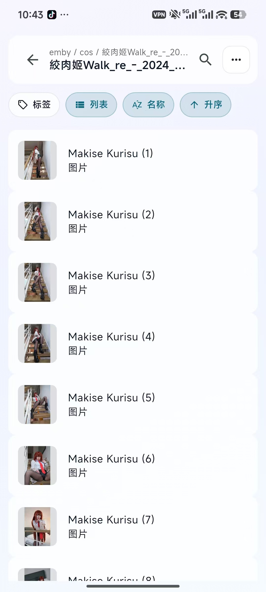

# Glacier

<p align="center">
  
</p>

<p align="center">
  <strong>把本地媒体、WebDAV 与 Emby 收进一个轻快的浏览与播放体验。</strong>
</p>

<p align="center">
  <a href="https://github.com/HlONGlin/Glacier/releases/tag/v2.03">下载 Android 版 v2.03</a>
  &nbsp;·&nbsp; Flutter 项目
</p>

Glacier 是一款以 Android 为主要目标平台的媒体浏览与播放应用。你可以整理常用媒体入口，在图片和视频目录中搜索、筛选，并从统一的界面继续浏览或播放。

## 下载

| 设备架构 | APK |
| --- | --- |
| ARM 64 位 | [下载](https://github.com/HlONGlin/Glacier/releases/download/v2.03/app-arm64-v8a-release.apk) |
| ARM 32 位 | [下载](https://github.com/HlONGlin/Glacier/releases/download/v2.03/app-armeabi-v7a-release.apk) |
| x86_64 | [下载](https://github.com/HlONGlin/Glacier/releases/download/v2.03/app-x86_64-release.apk) |

查看[完整发布说明](https://github.com/HlONGlin/Glacier/releases/tag/v2.03)。

## 应用截图

<p align="center">
  
  
  
</p>
<p align="center">
  
  
  
</p>

## 功能

### 多来源媒体库

- **本地目录**：浏览图片与视频，发现同目录字幕文件。
- **WebDAV**：访问远程目录及媒体，支持封面与缓存。
- **Emby**：浏览媒体库、继续播放、同步封面与播放进度，并支持字幕轨道和播放会话。
- 通过收藏夹集中管理常用目录和媒体入口。

### 浏览与播放

- 列表和图片视图、搜索、标签筛选与排序。
- 图片沉浸式查看、连续浏览与位置恢复。
- 视频倍速、字幕、播放历史和进度恢复。
- 播放时查看目录并快速切换媒体。
- 移动端方向控制与屏幕方向锁定。

### 管理与隐私

- 管理标签、历史记录和媒体缓存。
- 导出日志，备份与恢复账号、收藏及设置。
- 设置页提供离线文件管理。
- Emby 专属界面的媒体删除开关默认关闭。开启后仍会受服务器权限控制，执行删除前需要确认。
- 账号密码等敏感信息通过安全存储保存。

## 本地运行

需要安装 Flutter SDK。Dart SDK 版本范围为 `>=3.3.0 <4.0.0`。

```bash
flutter pub get
flutter run -d android
```

检查代码并构建 Android APK：

```bash
flutter analyze lib
flutter build apk --release
```

通用 APK 输出位置为 `build/app/outputs/flutter-apk/app-release.apk`。

## 技术栈

- Flutter 与 Dart
- `media_kit`、`media_kit_video`、`video_player`
- `shared_preferences`、`flutter_secure_storage`
- `file_picker`、`path_provider`、`video_thumbnail`

## 项目结构

| 目录 | 用途 |
| --- | --- |
| `lib/core/` | 设置、缓存、网络和安全存储等基础能力 |
| `lib/pages/` | 页面与媒体目录交互 |
| `lib/player/` | 播放器及其状态、字幕和控制逻辑 |
| `lib/image/` | 图片查看器 |
| `lib/emby/` | Emby 专属界面与辅助逻辑 |
| `lib/tag/` | 标签功能 |
| `lib/sources/` | 媒体来源与账号工具 |
| `assets/feature/` | README 功能截图 |

更多代码结构说明见 [`lib/README.md`](lib/README.md)。
